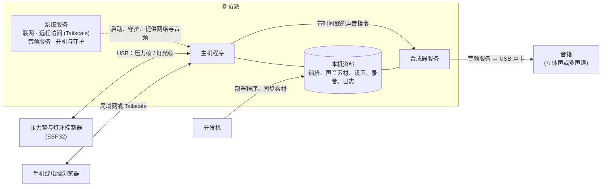
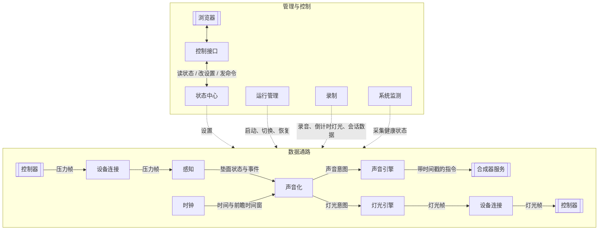
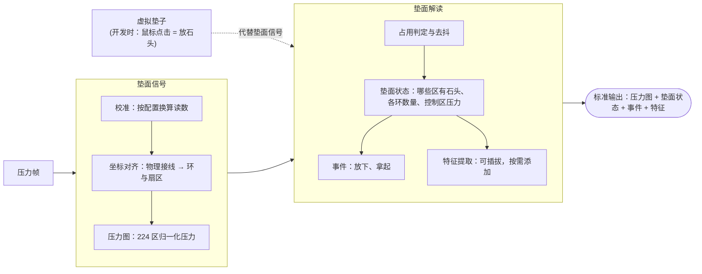
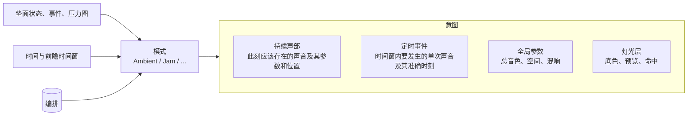
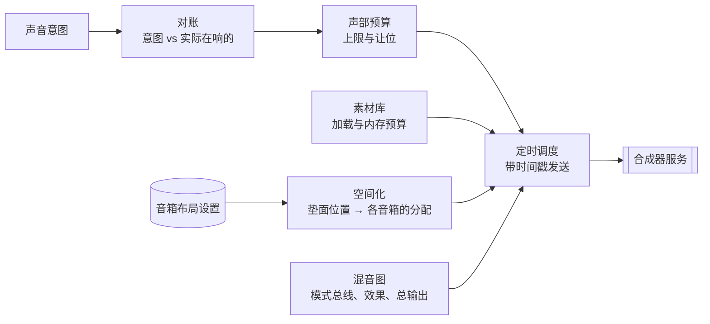
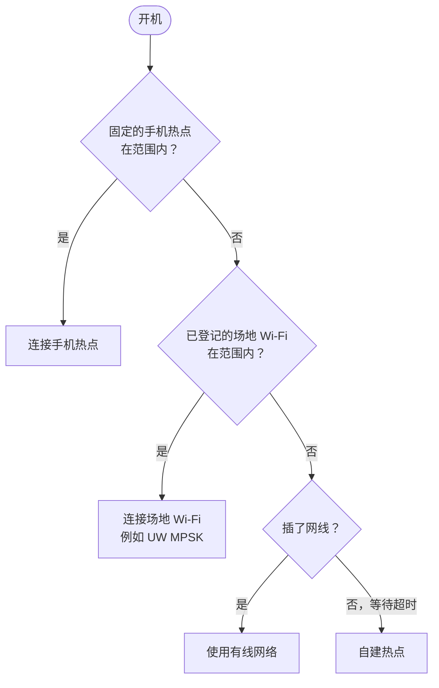
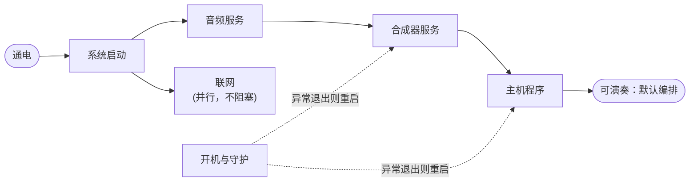
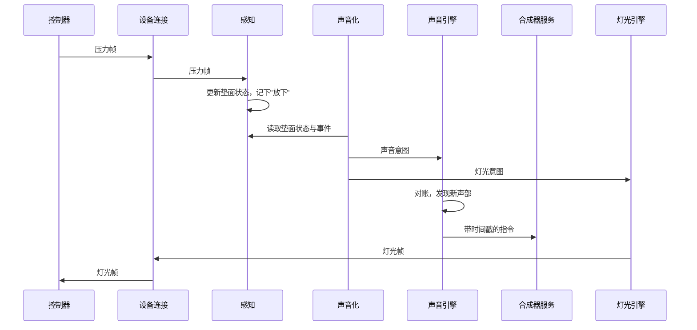

# Architecture

装置本身应有的行为（交互、声音化、灯光、编排）属于 Design，见 SoundMat 系列文档（尤其是第 2 篇产品设计哲学、第 5 篇传感器、第 7 篇固件、第 8 篇交互与声音化），以及 GYDC 的 Expression 要求；这些资料在哪里、哪几篇与本系统有关，见 `design/SOUNDMAT_SERIES.md`。本文描述树莓派这台机器整体怎样让这些行为成立：硬件接口、系统服务、主机程序和运维。

## 整体架构

树莓派是 SoundMat 的大脑。它通过 USB 从压力垫控制器接收压力读数、把灯光帧发回去，通过 USB 声卡把声音送到音箱，通过网络让人用手机或电脑查看和控制。机器内部有三类东西：系统服务（联网、远程访问、音频服务、开机与守护）；合成器服务负责实际发声；主机程序负责理解垫面并决定此刻的声音和灯光。编排、声音素材、设置、录音和日志都存放在本机。



整台机器以离线为前提工作。通电后不等待任何网络就进入可演奏状态；网络只用于控制台、维护和部署，断网不影响装置发声。

## 主机程序

主机程序分成两部分。**数据通路**把读数变成声音和灯光，沿一个方向流动。**管理与控制**负责设置、状态、录制、健康监测、启动和恢复，不参与逐帧的数据处理。



图中的设备连接和控制器各出现两次，分别画出"收"和"发"两个方向，实际是同一个模块、同一个设备。

模块边界按"谁做艺术决定"划分。**声音化是唯一做艺术决定的地方**：响什么、在哪里响、灯怎么亮，都由它描述。它不接触任何外部设备，只输出意图。**引擎只负责把意图变成现实**：声部起停、淡入淡出、声部上限、定时、空间分布、刷新，都与具体音乐无关，所有模式共用同一套。

**感知是全系统唯一理解垫面的地方。** 它对外提供一份标准化的垫面状态，声音化、控制台和录制都只依赖这份标准输出，不各自处理原始读数。

**意图是声明式的。** 声音化描述"此刻应该存在哪些持续的声音"，而不是"现在去打开某个声音"；声音引擎拿它和实际在响的声音对账。这带来两个系统性质：模式可以随时切换或重新计算，不会留下孤立的声音；合成器服务崩溃重启后，只需把当前意图重新对账一次，声音就恢复了。

**状态中心是设置和运行状态的唯一来源。** 默认编排、音量、音箱布局这类随场地变化的设置在这里持久保存；控制台看到的状态和调参的入口都经过它，任何变化都会通知订阅者。传感器校准、坐标与灯带对齐、声部预算这类描述硬件本身的参数是配置：写在仓库的配置文件里，启动时读取，运行中不变。

**节奏与时延。** 数据通路是异步的：感知、声音化、灯光引擎各按自己的节奏运行，彼此之间只交换最新值，不互相等待。感知每收到一帧就更新垫面状态；声音化按时钟的固定节拍（默认每秒 60 次，与灯光刷新率一致，可在设置中调整）读取最新的垫面状态，并取走上一拍之后感知积累的全部事件（放下、拿起），所以不论两边节奏如何，没有事件会丢失；灯光引擎每秒 60 次读取最新的灯光意图。额外的等待最多一个节拍（约 17 毫秒），人感觉不到；没有新帧时它也照常推进，控制器断线、重连或帧率下降时，扫描线、持续的声音和灯光动画都不会停住。声音的节奏精度靠带时间戳的指令保证，不依赖任何一层的节拍。传感帧率由控制器决定（扫描一遍传感器的时间、串口发送、刷新灯带都在同一个循环里），灯光的实际刷新率也受它限制；系统监测持续显示实测值。

## 感知

感知分两级。**垫面信号**把原始读数变成干净、对齐的压力图，是对传感器的忠实描述；**垫面解读**在压力图之上判断哪里有石头、发生了什么。两级之间的接口是标准化的，换一块传感器、换一套校准方法只影响第一级；换一种判断石头的方法只影响第二级。



压力图和垫面状态都随标准输出一起提供：多数模式只看"哪里有石头"，需要连续压力的模式（如 Jam 的控制区）直接读压力图。特征提取是可插拔的扩展点，例如整体分布、重心、挪动识别；每加一种特征都应先讨论它服务哪条 Design 要求，再加入标准输出。校准参数在真机上测定后写进配置文件，运行中不调整。

**虚拟垫子**用于在开发机上直接开发：在浏览器里点一个区就是放一颗石头，再点一次就是拿起。它产生一张压力图，从垫面信号的出口接入，之后的垫面解读、声音化、声音引擎和合成器服务都和真机完全一样。开发机上不需要控制器，也不需要串口。

## 声音化

声音化由两部分组成：**模式**是代码，定义一类交互逻辑，例如 Ambient 的音池、Jam 的旋转扫描；**编排**是数据，定义具体的声音世界，例如《京都岚山》的编排表、Lo-Fi 第一首的和弦与旋律表。新的声音世界只需要写编排；新的交互逻辑才需要写模式。编排只引用声音素材和音色，不包含它们：同一段录音或同一个音色可以被多个编排使用，素材库和音色定义各自独立维护，编排引用的素材缺失时由系统监测报告。灯光反馈与声音出自同一份状态，也在这里决定，和系列文档第 8 篇把交互、声音化与灯光放在一起的思路一致。



每一拍，模式根据最新输入给出完整意图。声音和事件都可以带一个垫面位置（角度、半径），交给声音引擎的空间化，让石头在垫面上的方位对应声音在房间里的方位。

## 声音引擎

声音引擎把声音意图变成合成器服务能执行的指令，对所有模式一视同仁。



**带时间戳的指令**的意思是：主机程序不说"现在响"，而是说"在某个准确时刻响"，并提前一小段时间发出；合成器服务按自己的音频时钟在那个时刻执行。主机程序的计算会有毫秒级的抖动，但声音落在准确的时刻上，节奏因此是稳的。代价是声音整体晚了"提前量"那么一点，所以这个提前量由模式决定：Jam 这类需要节奏精度的模式提前算出前瞻时间窗内的事件；Ambient 不需要，直接以当前时刻为准。

混音图为每个模式分配独立的一组总线和效果，切换编排时新旧两组可以同时存在、交叉淡化。音箱布局是设置而不是代码，立体声、四声道或八声道只是不同的布局。素材库按编排加载和卸载声音素材，并在加载前检查内存预算。

## 灯光引擎、设备连接与运行管理

灯光引擎按固定刷新率工作，尽量取硬件允许的最高值：每一帧取当前灯光意图，按层合成，施加灯带的物理对齐偏移，交给设备连接。刷新率由它统一决定，与声音化每秒算几次无关。录制倒计时这类系统提示也作为一层灯光，叠在声音化给出的灯光之上。

设备连接负责与控制器的链路：解析和校验压力帧，编码灯光帧，在开机时等待控制器就绪，断线后自动重连，并向状态中心报告链路健康和实测帧率。

运行管理是唯一能启动和停止其他模块的地方。它按顺序启动设备连接、感知、引擎和默认编排；编排切换由它协调；任何依赖失败时，它决定是重试、降级还是退出，并保证装置在无人值守时能自己恢复。

## 录制

录制服务后期制作：录下干净的声音，并能和视频对齐。

一次录制同时产生三样东西：

1. **总输出音频**：在合成器服务内部直接录下最终输出，没有环境噪声；接多声道音箱时就是多声道文件。
2. **分轨**：每环一轨，加上共用效果的回送各一轨，后期可以单独调平衡。
3. **会话数据**：压力图、事件、意图、灯光，全部带时间戳，可以用来做与视频同步的垫面动画，以后也可以作为虚拟垫子的回放来源。

开始录制时，灯环先做 3、2、1 的倒计时；倒计时结束的瞬间灯环全亮闪一下，同时发出一声短促的提示音，并在录音和会话数据里记下这个时刻。这一下就是打板：剪辑时在画面里找闪光的那一帧、在声音里找提示音，就能把录音和视频对齐到一帧以内。日常对齐交给剪辑软件按波形自动同步（相机自带麦克风录到的现场声音就够用），打板作为兜底；录音文件也记下开始的准确时间，用于粗对齐。录制前检查剩余空间，空间不足时拒绝开始并提示。

## 系统监测

系统监测持续检查整台机器是否处在能正常演奏的状态，结果放进状态中心，由控制台的信息看板显示。最重要的是音频链路，因为它出问题时装置往往"看起来在运行，但没有声音"：

1. **音频链路**：音频服务是否在运行；USB 声卡是否在、是否被选中；合成器服务是否存活；它实际使用的输出设备、采样率、声道数、缓冲设置是否与设置一致；音色定义和声音素材是否全部加载、缺了哪些文件；音频卡顿次数；运算负载；同时在响的声部数；输出电平。还提供逐个声道的测试音，用来确认每只音箱接对了位置。
2. **控制器链路**：是否连接、实测传感帧率（固件在同一个循环里刷新灯带，这也是实物灯带的实际刷新率）、校验错误数。
3. **节奏**：各条链路的实测帧率与期望值（传感、垫面解读、声音化节拍、灯光引擎、写给控制器的灯光、推送到控制台），节拍延迟与定时事件迟到。
4. **机器与主机程序**：CPU 温度与是否降频、内存、剩余空间与还能录多久、机器和主机程序的运行时长、主机程序自动重启的次数、当前运行的版本。
5. **网络**：连接类型（手机热点、自建热点、外部网络、有线）、地址、Tailscale 状态。
6. **当前**：编排与模式、音量、录制状态，以及最近的警告和错误。

## 网络

网络从不阻塞开机和发声。树莓派开机后按优先级选择一个网络，全部失败时自建热点兜底：



**使用时**（展出、演示、拍摄）：现场的人用手机控制装置。手机打开固定的热点，树莓派优先连上它；没有手机热点时，树莓派自建热点，手机连过去。两种情况下手机和装置都在同一个局域网里，直接打开控制台。

**开发时**：开发机要部署程序、同步素材、登录查看日志。树莓派放在实验室时连已登记的场地 Wi-Fi（在 UW 用 UW MPSK：为无屏幕设备准备，登记设备后用独立密码连接；eduroam 需要证书登录，不适合）。校园网里两台设备未必能互相访问，所以开发机通过 Tailscale 到达树莓派；只要树莓派能上互联网（包括通过手机热点），在任何地方都能用同一个名字找到它。

## 开机与运维



开机顺序由系统的守护机制负责，每个服务异常退出都会被自动重启。主机程序启动后进入状态中心里设定的默认编排。控制器在通电后独立开机，在主机程序接管之前保持低亮度的等待灯效。

装置的全部配置都来自仓库：系统服务的配置、开机与守护规则、网络设置都随程序一起部署，换一张存储卡或换一台树莓派，可以从仓库完整重建。声音素材体积大，不进仓库，从开发机同步到本机资料目录。运行日志和录音保存在本机。

## 预留扩展

以下能力暂不实现，但架构为它们留好位置，加入时不需要改动模块边界：

1. **开放时段**：按时间自动开始、静音或进入夜间模式。时间表存在状态中心，由运行管理执行。
2. **音量上限**：一个不可被超过的最大音量，保护音箱和环境。上限存在状态中心，在声音引擎的总输出处强制执行。
3. **编排参数现场调整**：在控制台实时调整编排里的参数，满意后存回编排文件。编排把可调参数声明出来，通过状态中心暴露给控制台。
4. **会话回放**：把录制的会话数据作为虚拟垫子的输入，重放一次真实演奏。

## 一次典型运行：放下一颗石头



拿起石头时流程相同：下一拍的意图里少了这个声部，对账发现后让它淡出。开发机上用虚拟垫子时，前三步换成"浏览器点击 → 虚拟垫子产生压力图"，其余完全相同。

## 架构树

1. 树莓派
    1. 主机程序
        1. 运行管理：启动顺序、编排切换、失败重试与降级、无人值守恢复、退出
        2. 设备连接：与控制器的链路，链路健康与实测帧率
        3. 感知：全系统唯一的垫面理解，标准化输出
            1. 垫面信号：校准、坐标对齐、压力图
            2. 垫面解读：占用判定与去抖、垫面状态、事件、可插拔特征
            3. 虚拟垫子：开发时代替垫面信号
        4. 时钟：统一时间基准，声音化的固定节拍，音乐时间，前瞻时间窗
        5. 声音化：唯一做艺术决定的地方
            1. 模式：Ambient、Jam，以后的新交互
            2. 编排：编排表、和弦与旋律表等数据
            3. 意图：持续声部、定时事件、全局参数、灯光层
        6. 声音引擎：意图到指令，与具体音乐无关
            1. 对账
            2. 声部预算
            3. 定时调度
            4. 混音图：模式总线、效果、总输出、交叉淡化
            5. 空间化：垫面位置到音箱布局
            6. 素材库：加载、卸载、内存预算
        7. 灯光引擎：最高可行刷新率，分层合成，物理对齐，系统提示层
        8. 录制：总输出、分轨、会话数据，倒计时与打板
        9. 系统监测：音频链路、控制器链路、机器、网络、当前状态
        10. 状态中心：持久设置、运行状态、变化通知
        11. 控制接口：状态推送、设置修改、命令、虚拟垫子输入
    2. 合成器服务：音色定义与实际发声，内部录音
    3. 系统服务
        1. 联网：手机热点、场地 Wi-Fi、有线、自建热点
        2. 远程访问：Tailscale
        3. 音频服务：USB 声卡与多声道输出
        4. 开机与守护：启动顺序，异常重启
    4. 本机资料：编排、声音素材、设置、录音、日志
2. 树莓派之外
    1. 控制器固件：扫描传感器，驱动灯带
    2. 网页控制台：只通过控制接口与主机程序交互
    3. 开发机：开发、部署、同步声音素材；用虚拟垫子运行完整的主机程序

## 文件结构

以下是当前的结构，对应上面的逻辑架构。

```text
system/pi/soundmat/
├── README.md
├── AGENTS.md
├── docs/                    MukiDoc 文档；Design 层引用 SoundMat 系列文档
├── soundmat/                主机程序
│   ├── supervisor/          运行管理
│   ├── device/              设备连接
│   ├── perception/          感知
│   │   ├── signal/          垫面信号
│   │   ├── interpret/       垫面解读与特征
│   │   └── virtual/         虚拟垫子
│   ├── clock/               时钟
│   ├── sonification/        声音化
│   │   ├── intent.py        意图的定义（所有模式共用）
│   │   ├── mode.py          模式的生命周期；arrangements.py 读取编排
│   │   ├── ambient/         Ambient 模式
│   │   └── jam/             Jam 模式
│   ├── sound/               声音引擎
│   ├── light/               灯光引擎
│   ├── recorder/            录制
│   ├── monitor/             系统监测
│   ├── store/               状态中心
│   ├── control/             控制接口
│   └── updater/             软件更新：发布包格式、从 GitHub 安装、切换版本
├── config/                  配置：校准、对齐、声部预算等部署参数
├── arrangements/            编排（数据）：kyoto/、lofi_1/ 等
├── instruments/             合成器服务的音色定义（编译产物在 compiled/，不进仓库）
├── scripts/                 开发用脚本：编译音色、启动开发用的合成器服务、发布（release.py）
├── console/                 网页控制台（独立前端工程）
├── system/                  装进树莓派系统的配置
│   ├── systemd/             JACK、scsynth、主机程序三个服务，logind 设置
│   ├── network/             网络选择与自建热点兜底
│   └── update/              启动保护 soundmat-guard
├── skills/                  操作手册（通用的 Agent Skill 格式）：soundmat-deploy 部署、更新与排错
└── tests/
```

声音素材的正本在开发机的 `SoundMat/sound/`，发布时只把编排引用到的文件同步到树莓派的 `/home/soundmat/sound/`，路径由状态中心的设置指定。
